# Multi-Label Code Comment Classification (NLBSE’23)

[](#5-installation)
[](#5-installation)
[](#5-installation)
[](https://github.com/PhucDucMai/Code-Commnet-CLS/actions/workflows/tests.yml)

Classify every sentence of a source-code comment into the categories of the **NLBSE’23 code comment classification** dataset: 6,738 sentences from Java, Python and Pharo projects, **19 labels, multi-label** (a sentence can have several labels).

The repository contains a complete, reproducible study on one consumer GPU (RTX 5060, 8 GB):

* a **multi-label RoBERTa-large + LoRA** model with a training recipe for imbalanced labels (context prompt, Asymmetric Loss, weighted sampler, per-label thresholds),
* two **baselines** on the same folds: TF-IDF + Logistic Regression, and a plain-fine-tuned RoBERTa,
* the same recipe on **three other backbones** (DeBERTa-v3-large, ModernBERT-large, UniXcoder-base),
* **5-fold multilabel stratified cross-validation**, eight metrics, paired t-tests and error analysis,
* a **demo** (web + command line) that takes a `.java` / `.py` / `.st` file and labels its class comments.

**Main result** (5-fold CV, F1 samples): **0.8124 ± 0.0064**, **+0.240** over the RoBERTa baseline (0.5721) and **+0.211** over TF-IDF + LR (0.6015), better on **5 / 5 folds** (paired t-test p = 1.4 × 10⁻⁵).

<p align="center">
  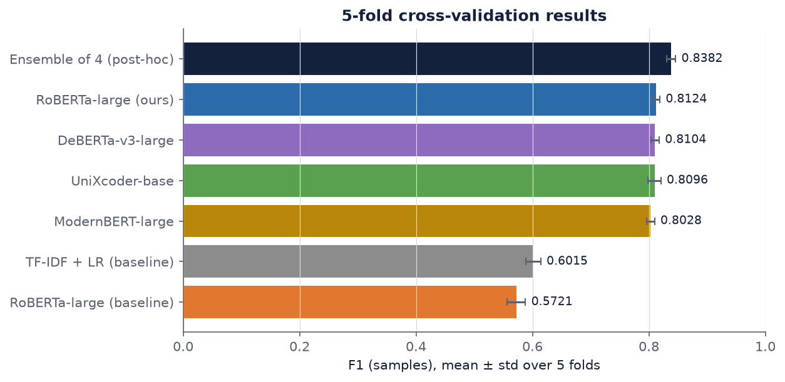
</p>

<p align="center">
  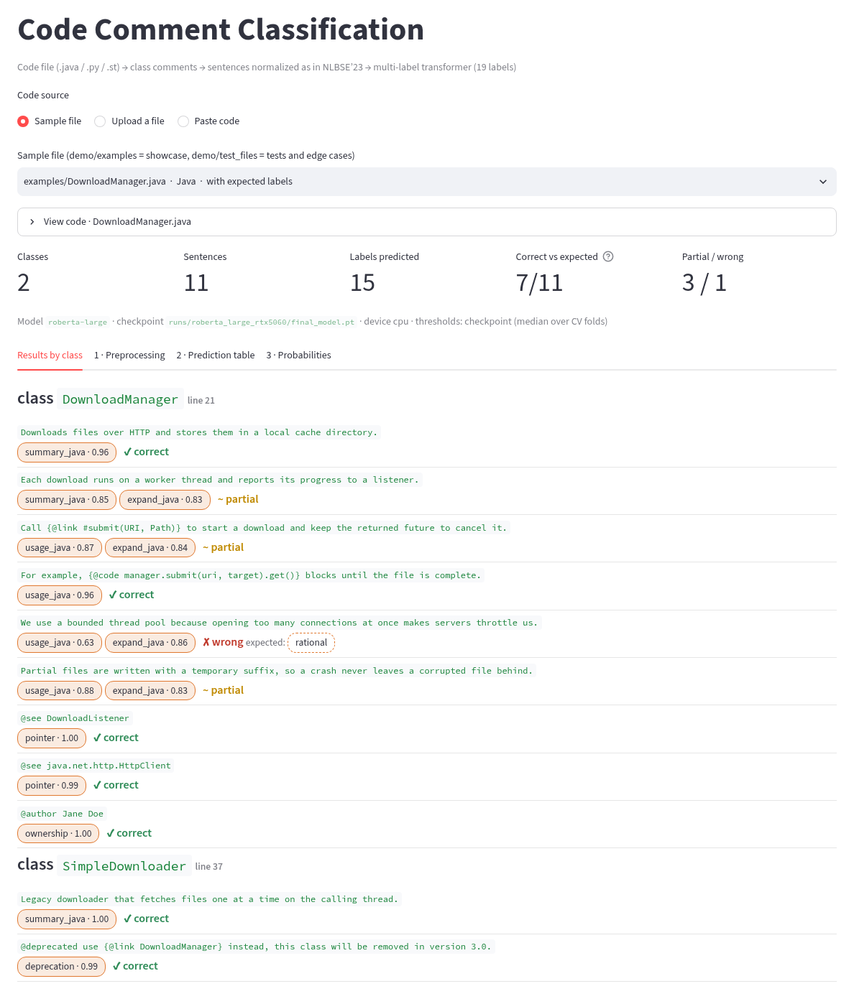
  <br><em>Demo: a Java file is split into class-comment sentences, each labelled with probabilities and checked against expected labels.</em>
</p>

---

## Contents

1. [Task and dataset](#1-task-and-dataset)
2. [Approach](#2-approach)
3. [Results](#3-results)
4. [Repository structure](#4-repository-structure)
5. [Installation](#5-installation)
6. [Quick start](#6-quick-start)
7. [Training](#7-training)
8. [Baselines](#8-baselines)
9. [Evaluation and analysis tools](#9-evaluation-and-analysis-tools)
10. [Demo and inference](#10-demo-and-inference)
11. [Evaluation protocol and limitations](#11-evaluation-protocol-and-limitations)
12. [Troubleshooting](#12-troubleshooting)
13. [Legacy code and references](#13-legacy-code-and-references)
14. [Citation, acknowledgments, license](#14-citation-acknowledgments-license)

---

## 1. Task and dataset

**Input:** one comment sentence, its language and its class name. **Output:** any subset of 19 labels.

| Language | Sentences | Labels |
|---|---:|---|
| Java | 2,418 | `summary_java`, `usage_java`, `expand_java`, `pointer`, `deprecation`, `rational`, `ownership` |
| Python | 2,555 | `summary_python`, `usage_python`, `expand_python`, `parameters`, `developmentnotes` |
| Pharo | 1,765 | `intent`, `responsibilities`, `collaborators`, `keymessages`, `example`, `keyimplementationpoints`, `classreferences` |

The dataset uses 16 label names; `summary`, `usage` and `expand` exist in both Java and Python and are split by language, giving **19 labels** (`data.expand_to_19_classes` in the configs).

**File:** `data/raw/sentences.csv` — columns `id`, `class_id`, `sentence`, `partition`, `labels` (`;`-separated), `lang`.

| Property | Value |
|---|---|
| Sentences / classes | 6,738 / 1,006 (≈ 6.7 sentences per class) |
| Multi-label sentences | 912 (13.5%): 816 with 2 labels, 90 with 3, 6 with 4 |
| Label imbalance | 912 sentences (`usage_java`) vs 77 (`classreferences`), ≈ 12× |
| Sentence length | median 6 words; 751 one-word lines (e.g. HTML tags `li`, `p`) |
| Context | 80% of adjacent sentences of the same class have identical labels |
| Original split (`partition`) | 5,392 train / 1,346 test (not used by the 5-fold CV, see [§11](#11-evaluation-protocol-and-limitations)) |

Sentences are lowercased fragments of class comments, e.g. `@link #applicationstarted applicationstartdata is supposed to` → `expand_java`, `pointer`.

<p align="center">
  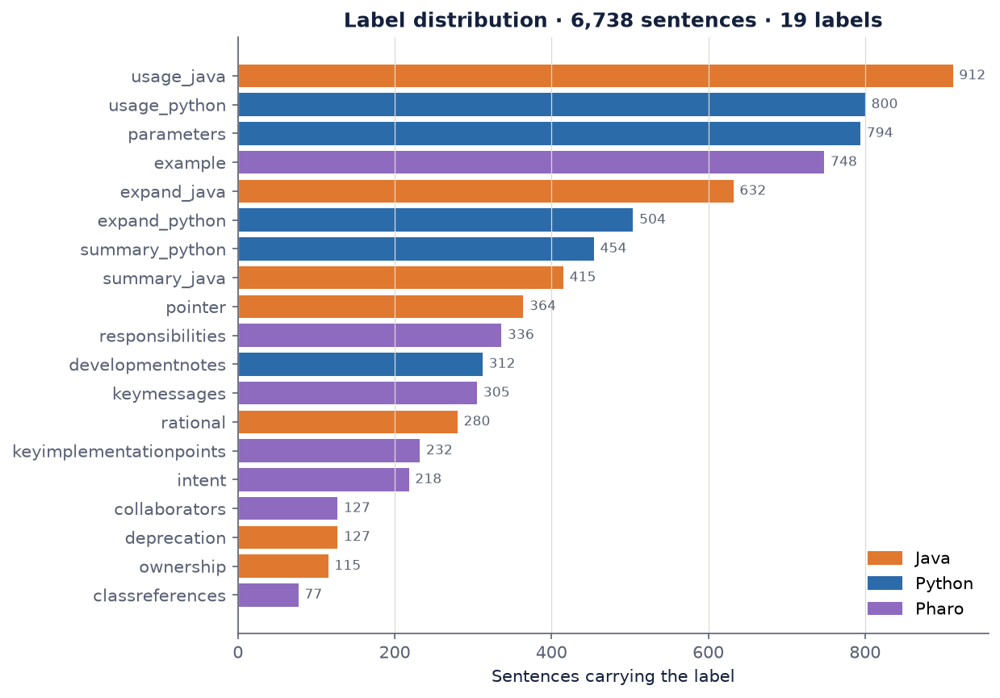
</p>

---

## 2. Approach

### Model

```
"[JAVA] Abfss.java | this impl delegates to the old filesystem"      ← context prompt
        │
   tokenizer (max 128 tokens)
        │
   RoBERTa-large + LoRA (r = 32, α = 64, dropout 0.05, on query/key/value/dense)
        │
   masked mean pooling over non-padding tokens (instead of [CLS]; ablation in §3.9)
        │
   MLP head 1024 → 512 → 19 (LayerNorm, GELU, dropout)
        │
   19 sigmoid probabilities → one decision threshold per label → labels
```

One multi-label model instead of 19 binary models: one forward pass for all labels, a representation shared by frequent and rare labels, one checkpoint and one threshold vector to deploy. 14.76M of 370.1M parameters are trained (LoRA + head).

### Training recipe (what differs from plain fine-tuning)

| # | Component | Plain fine-tuning (RoBERTa baseline) | Our recipe |
|---|---|---|---|
| 1 | Input | sentence only | context prompt `[LANG] class_id \| sentence` |
| 2 | Loss | binary cross-entropy | Asymmetric Loss (γ⁺ = 0, γ⁻ = 4, clip = 0.05): easy negatives are down-weighted by p⁴ |
| 3 | Sampling | random | `WeightedRandomSampler`, weight of a sentence = Σ 1 / frequency of its labels |
| 4 | Decision | threshold 0.5 | per-label thresholds: 100-value grid per label, then coordinate descent on F1 (samples) |

Model selection: the epoch with the best validation F1 (samples) of each fold; early stopping after 5 epochs without improvement, never before epoch 10.

---

## 3. Results

All numbers below come from the runs in `runs/` and can be regenerated with `scripts/compare_runs.py` and `scripts/analyze_oof.py` ([§9](#9-evaluation-and-analysis-tools)). Mean ± std over the 5 folds; every method uses **the same folds**.

### 3.1 Overall

| Method | F1 samples | F1 micro | F1 macro | PR-AUC | ROC-AUC | Jaccard | Exact match | Hamming ↓ | CV time |
|---|---:|---:|---:|---:|---:|---:|---:|---:|---:|
| Baseline · TF-IDF + LR | 0.6015 ± 0.0127 | 0.5871 | 0.5893 | 0.6194 | 0.9155 | 0.5470 | 0.3973 | 0.0594 | 30 s (CPU) |
| Baseline · RoBERTa-large | 0.5721 ± 0.0159 | 0.6050 | 0.5743 | 0.6194 | 0.9177 | 0.5571 | 0.5129 | 0.0432 | 2 h 26 min |
| **Ours · RoBERTa-large** | **0.8124 ± 0.0064** | **0.7973** | **0.7829** | 0.8198 | 0.9665 | **0.7790** | **0.6805** | **0.0260** | 2 h 41 min |
| Same recipe · UniXcoder-base | 0.8096 ± 0.0109 | 0.7956 | 0.7821 | **0.8233** | **0.9712** | 0.7733 | 0.6658 | 0.0264 | 1 h 01 min |
| Same recipe · DeBERTa-v3-large | 0.8104 ± 0.0072 | 0.7910 | 0.7743 | 0.8088 | 0.9556 | 0.7753 | 0.6726 | 0.0270 | 3 h 46 min |
| Same recipe · ModernBERT-large | 0.8028 ± 0.0069 | 0.7851 | 0.7653 | 0.8025 | 0.9599 | 0.7684 | 0.6679 | 0.0277 | 2 h 30 min |
| Ensemble of the 4 transformers (post-hoc) | 0.8382 ± 0.0076 | 0.8214 | 0.8087 | 0.8614 | 0.9815 | 0.8049 | 0.7063 | 0.0230 | — |

Best single model in bold. The ensemble averages the out-of-fold probabilities of the four transformer runs and re-tunes the thresholds per fold.

### 3.2 Comparison with the RoBERTa baseline

Same backbone, folds, epochs and learning rate; only the four recipe components differ.

| | F1 samples per fold | Mean |
|---|---|---:|
| Ours − RoBERTa baseline | +0.2415 · +0.2062 · +0.2617 · +0.2531 · +0.2390 | **+0.2403**, 5 / 5 folds, t = 25.39, p = 1.4 × 10⁻⁵ |
| Ours − TF-IDF + LR | +0.2177 · +0.1839 · +0.2260 · +0.2186 · +0.2085 | **+0.2110**, 5 / 5 folds, t = 28.84, p = 8.6 × 10⁻⁶ |

<p align="center">
  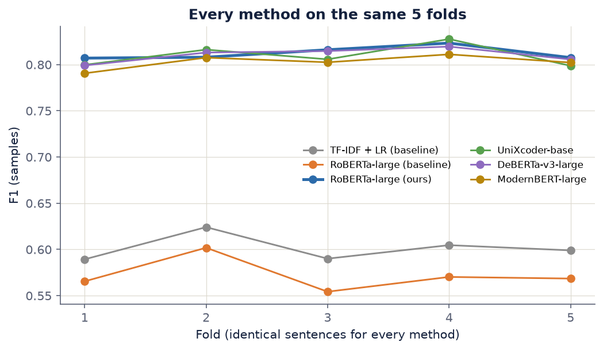
</p>

### 3.3 Where the gain comes from

Decision rules applied post-hoc to the RoBERTa baseline’s out-of-fold predictions (no retraining):

| Step | F1 samples |
|---|---:|
| RoBERTa baseline, threshold 0.5 | 0.5721 |
| + at least one label per sentence | 0.6043 |
| + per-label threshold search | 0.6317 |
| Ours (+ context prompt + Asymmetric Loss + weighted sampler) | 0.8124 |

Thresholds explain ≈ +0.06; the training changes (prompt, loss, sampler, measured together) explain ≈ +0.18. The threshold-independent PR-AUC rises from 0.6194 to 0.8198.

<p align="center">
  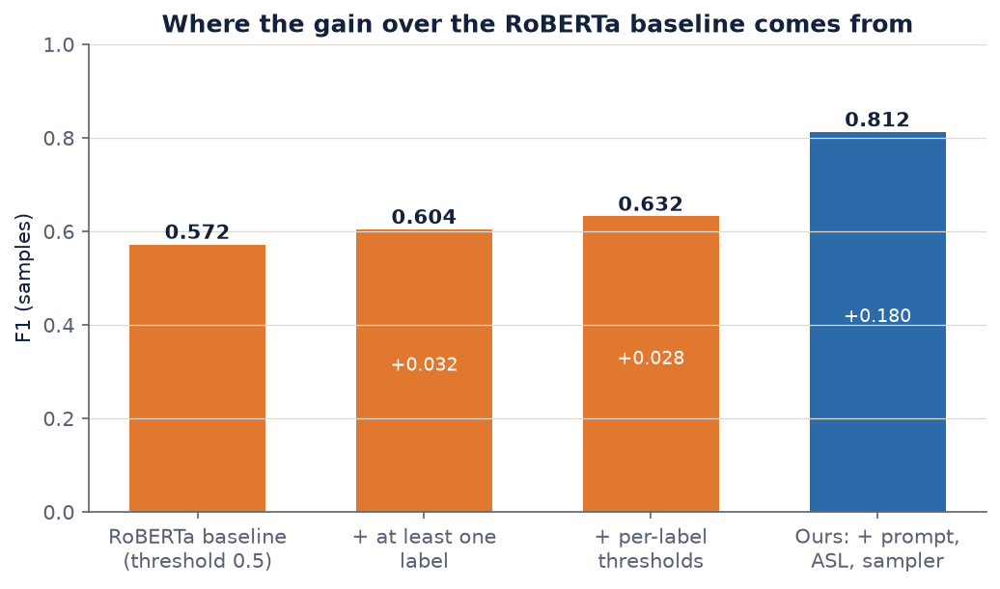
</p>

**Why the RoBERTa baseline is below TF-IDF on F1 samples:** with BCE and a fixed 0.5 threshold it predicts no label for 13.6% of the sentences (each scores F1 = 0) and 0.93 labels per sentence on average (true: 1.15), while the TF-IDF baseline tunes its thresholds. With the same threshold tuning the RoBERTa baseline reaches 0.6317 > 0.6015, and it is already better on F1 micro, exact match and Hamming loss.

### 3.4 Backbones (same recipe)

| vs ours (0.8124) | F1 samples | Δ | Folds where ours wins | p (paired t-test) | Params (incl. LoRA + head) | Peak VRAM |
|---|---:|---:|---:|---:|---:|---:|
| RoBERTa-large (ours) | 0.8124 | — | — | — | 370.1M | 4.8 GB |
| UniXcoder-base | 0.8096 | −0.0028 | 3 / 5 | 0.50 | 131.6M | 1.8 GB |
| DeBERTa-v3-large | 0.8104 | −0.0020 | 4 / 5 | 0.40 | 448.7M | 5.4 GB |
| ModernBERT-large | 0.8028 | −0.0096 | 5 / 5 | 0.03 | 409.7M | 5.1 GB |
| Ensemble of the 4 | 0.8382 | +0.0258 | 0 / 5 | 1.5 × 10⁻⁴ | — | — |

With the same recipe the four encoders end within 0.01 of each other. UniXcoder-base (pretrained on code) matches RoBERTa-large with 2.8× fewer parameters, 2.6× less training time and 2.7× less memory.

<p align="center">
  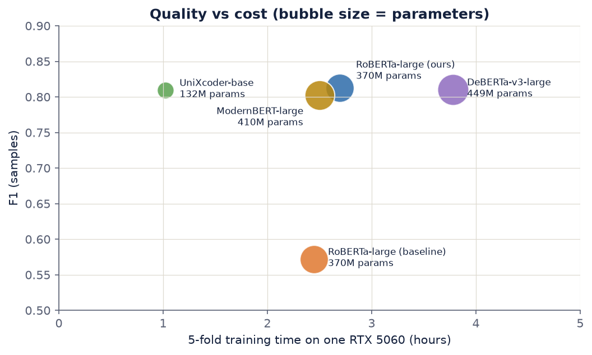
</p>

### 3.5 Per language (macro F1 over the language’s labels)

| Method | Java | Python | Pharo |
|---|---:|---:|---:|
| Baseline · RoBERTa-large | 0.6837 | 0.4733 | 0.5372 |
| Baseline · TF-IDF + LR | 0.6861 | 0.5197 | 0.5423 |
| **Ours · RoBERTa-large** | **0.8478** | 0.7341 | **0.7529** |
| UniXcoder-base | 0.8463 | **0.7357** | 0.7510 |
| DeBERTa-v3-large | **0.8560** | 0.7219 | 0.7301 |
| ModernBERT-large | 0.8459 | 0.7213 | 0.7162 |

<p align="center">
  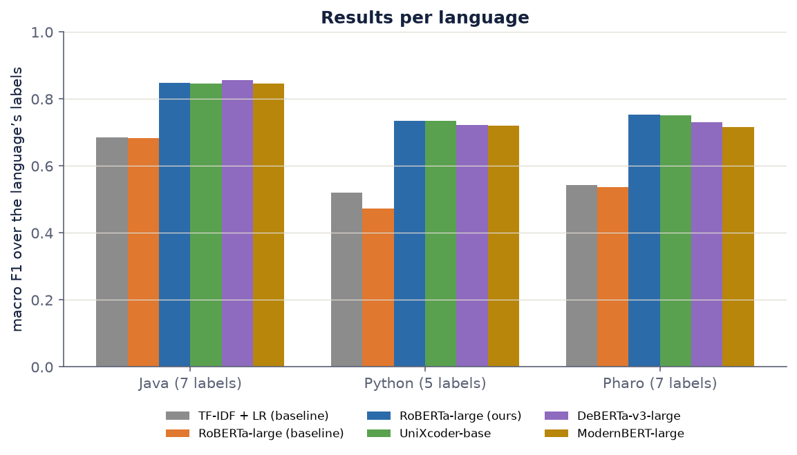
</p>

### 3.6 Per label (F1, mean over folds)

<p align="center">
  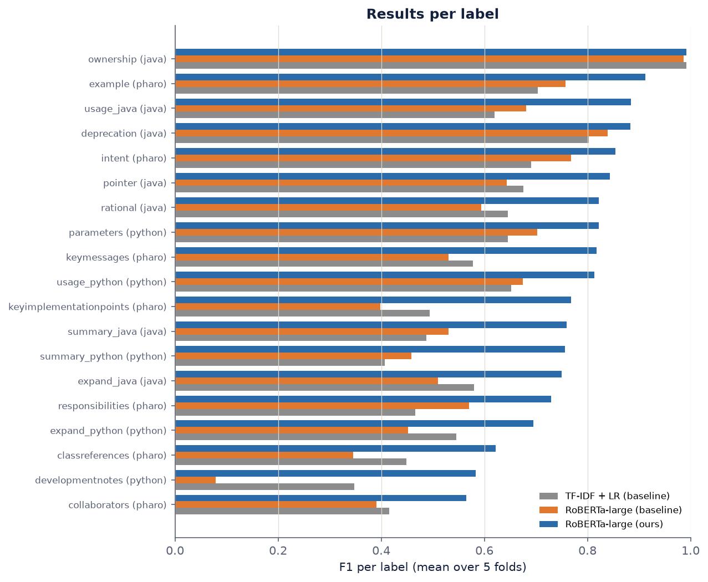
</p>

| Label | Language | Sentences | TF-IDF + LR | RoBERTa baseline | Ours |
|---|---|---:|---:|---:|---:|
| `ownership` | Java | 115 | 0.9913 | 0.9867 | 0.9913 |
| `example` | Pharo | 748 | 0.7034 | 0.7569 | 0.9126 |
| `usage_java` | Java | 912 | 0.6202 | 0.6809 | 0.8843 |
| `deprecation` | Java | 127 | 0.8026 | 0.8395 | 0.8837 |
| `intent` | Pharo | 218 | 0.6905 | 0.7681 | 0.8546 |
| `pointer` | Java | 364 | 0.6759 | 0.6436 | 0.8435 |
| `parameters` | Python | 794 | 0.6457 | 0.7025 | 0.8224 |
| `rational` | Java | 280 | 0.6458 | 0.5944 | 0.8224 |
| `keymessages` | Pharo | 305 | 0.5783 | 0.5306 | 0.8172 |
| `usage_python` | Python | 800 | 0.6522 | 0.6749 | 0.8132 |
| `keyimplementationpoints` | Pharo | 232 | 0.4935 | 0.3978 | 0.7685 |
| `summary_java` | Java | 415 | 0.4873 | 0.5305 | 0.7595 |
| `summary_python` | Python | 454 | 0.4068 | 0.4581 | 0.7567 |
| `expand_java` | Java | 632 | 0.5795 | 0.5104 | 0.7502 |
| `responsibilities` | Pharo | 336 | 0.4655 | 0.5701 | 0.7294 |
| `expand_python` | Python | 504 | 0.5457 | 0.4523 | 0.6945 |
| `classreferences` | Pharo | 77 | 0.4490 | 0.3457 | 0.6224 |
| `developmentnotes` | Python | 312 | 0.3482 | 0.0785 | 0.5836 |
| `collaborators` | Pharo | 127 | 0.4157 | 0.3909 | 0.5654 |

### 3.7 Error analysis of the main model

* Most frequent confusions (true label missed → other label predicted): `expand_java` → `summary_java` (46) and → `usage_java` (46); `parameters` → `usage_python` (31); `usage_python` → `expand_python` (31); `expand_python` → `summary_python` (30); `developmentnotes` → `summary_python` (30).
* Exact match by number of true labels: 1 label 70.9% (n = 5,826), 2 labels 52.0% (n = 816), 3–4 labels 33.3% (n = 96).
* Exact match by language: Java 71.4%, Python 62.7%, Pharo 71.2%.
* Slight over-prediction: 1.28 labels per sentence vs 1.15 true (recall 0.857 > precision 0.800), since thresholds maximize F1 (samples).

<p align="center">
  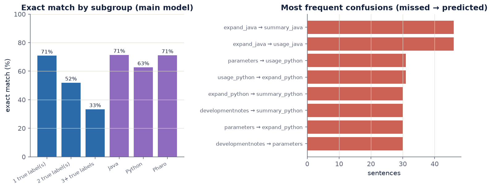
</p>

### 3.8 Training curves

The main model reaches 0.78 F1 (samples) at epoch 10 and its best epochs are 23–28. Its validation loss is lowest at epochs 12–17 in the individual folds (epoch 11 on the mean curve) and then rises slightly while F1 keeps improving: probabilities become over-confident while the ranking of labels still gets better, which the per-label thresholds compensate. The RoBERTa baseline predicts no label at all during its first 3 epochs.

<p align="center">
  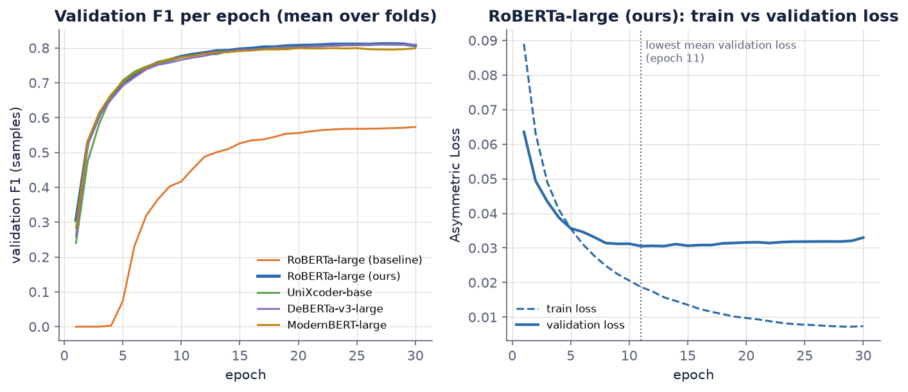
</p>

### 3.9 Pooling ablation: mean pooling vs first token

Same model, recipe, folds and seed as ours; only the sentence vector changes: the mean of the non-padding tokens (ours) or the first token `<s>` (the `[CLS]` equivalent of RoBERTa). Run: `runs/ablation_cls_pooling` (`configs/ablation_cls_pooling.yaml`).

| Pooling | F1 samples | F1 micro | F1 macro | PR-AUC | ROC-AUC | Jaccard | Exact match | Hamming ↓ | CV time |
|---|---:|---:|---:|---:|---:|---:|---:|---:|---:|
| Mean (ours) | 0.8124 ± 0.0064 | 0.7973 | 0.7829 | 0.8198 | 0.9665 | 0.7790 | 0.6805 | 0.0260 | 2 h 41 min |
| First token `<s>` | 0.8089 ± 0.0074 | 0.7950 | 0.7803 | 0.8176 | 0.9664 | 0.7750 | 0.6751 | 0.0262 | 2 h 50 min |

| Test (mean − first token) | Result |
|---|---|
| F1 samples per fold | +0.0040 · −0.0086 · +0.0127 · +0.0042 · +0.0054 → **+0.0035**, mean pooling wins 4 / 5 folds, paired t-test p = 0.36 |
| Paired bootstrap over the 6,738 out-of-fold sentences (5,000 resamples) | Δ F1 samples = +0.0036, 95% CI [−0.0023, +0.0093] |
| McNemar test on exact match | 496 sentences right only with mean pooling, 460 only with `<s>`, p = 0.26 |
| Per language (macro F1) | Java −0.0057 · Python +0.0078 · Pharo +0.0071 |
| Per label | mean pooling better on 12 / 19 labels |

**Conclusion:** mean pooling is slightly ahead on almost every metric, but the difference (≈ 0.004) is smaller than the fold-to-fold spread (std ≈ 0.007) and no test is significant. On this task the pooling choice does not matter measurably; the gain over the RoBERTa baseline (+0.24, [§3.2](#32-comparison-with-the-roberta-baseline)) comes from the training recipe. Each setting was trained once (one seed), so GPU non-determinism is part of the observed difference.

---

## 4. Repository structure

```
CodeCommentClassification/
├── src/                           # shared code (imported by scripts/ and demo/)
│   ├── train.py                   # training: 5-fold CV + final model, metrics, thresholds, logging
│   └── preprocess_comments.py     # code file → class comments → normalized sentences → model input
├── scripts/                       # command-line tools, run from the repository root
│   ├── run_experiments.py         # train every model of configs/experiments.yaml with one command
│   ├── ml_baseline.py             # TF-IDF + Logistic Regression baseline on the same folds (CPU)
│   ├── compare_runs.py            # tables + chart comparing runs fold by fold
│   ├── analyze_oof.py             # behaviour, decision-rule ablation, t-tests, ensemble, error analysis
│   ├── make_figures.py            # regenerate the README figures in docs/images/ from runs/
│   └── rebuild_oof.py             # recompute out-of-fold predictions/metrics of an older run
├── configs/
│   ├── train_rtx5060.yaml         # main method, fits an 8 GB GPU (default of src/train.py)
│   ├── baseline_roberta.yaml      # RoBERTa baseline (plain fine-tuning)
│   ├── ablation_cls_pooling.yaml  # ablation: first-token (<s>) pooling instead of mean pooling
│   ├── experiments.yaml           # list of models for scripts/run_experiments.py
│   ├── train_l40s.yaml            # original config of the upstream repository (46 GB GPU)
│   └── smoke_test.yaml            # 2 folds × 1 epoch with roberta-base, to check the setup
├── demo/
│   ├── app.py                     # Streamlit web demo
│   ├── cli.py                     # command-line demo
│   ├── inference.py               # load a trained run, classify a code file
│   ├── examples/                  # 8 showcase files + expected_labels.json
│   └── test_files/                # 10 test files with varied styles and edge cases
├── tests/                         # pytest suite: extraction, data consistency, metrics, loss, model (CPU, no weights)
├── docs/images/                   # figures and screenshots used in this README
├── data/
│   ├── raw/sentences.csv          # NLBSE’23 dataset
│   └── processed/splits.json      # split file of the upstream repository (not used)
├── runs/                          # one folder per run: results committed, model weights and logs git-ignored
├── legacy/                        # upstream per-category ML scripts, not runnable (see legacy/README.md)
├── references/STACC/              # NLBSE’23 submission of TU Delft (SetFit), for reference
├── requirements.txt
├── .github/workflows/             # CI (tests.yml) and release (release.yml) on GitHub Actions
├── requirements-dev.txt           # requirements.txt + pytest + ruff
├── requirements-test.txt          # minimal dependencies of the test suite (CI, with CPU PyTorch)
├── pytest.ini · ruff.toml         # test and lint settings
└── README.md
```

---

## 5. Installation

```bash
git clone https://github.com/dang-nh/CodeCommentClassification.git
cd CodeCommentClassification

conda create -n ccc python=3.12 -y
conda activate ccc

# 1. PyTorch with CUDA matching your GPU (RTX 50xx / Blackwell needs CUDA 12.8 or newer), e.g.:
pip install torch --index-url https://download.pytorch.org/whl/cu128
# 2. Everything else
pip install -r requirements.txt

# Check
python -c "import torch; print(torch.cuda.is_available(), torch.cuda.get_device_name(0))"
```

Tested with Python 3.12, PyTorch 2.13 (CUDA build), transformers 4.57, peft 0.21, scikit-learn 1.9, Streamlit 1.61 on an RTX 5060 (8 GB). `sentencepiece` is needed for DeBERTa-v3; ModernBERT needs transformers ≥ 4.48. Pretrained weights are downloaded from the Hugging Face Hub on first use.

---

## 6. Quick start

All commands run **from the repository root** (paths in the configs are relative to it).

```bash
# 0. Check the setup in a few minutes (roberta-base, 2 folds, 1 epoch)
python src/train.py configs/smoke_test.yaml

# 1. Machine learning baseline (CPU, ≈ 30 s)
python scripts/ml_baseline.py

# 2. All transformer runs in one go (main model, RoBERTa baseline, 3 other backbones); overnight
python scripts/run_experiments.py --dry-run     # show the plan
python scripts/run_experiments.py               # use tmux: it runs for hours

# 3. Analysis and figures
python scripts/compare_runs.py runs/baseline_roberta_large runs/ml_tfidf_logreg runs/roberta_large_rtx5060
python scripts/analyze_oof.py
python scripts/make_figures.py

# 4. Demo
streamlit run demo/app.py
```

---

## 7. Training

### 7.1 One model: `src/train.py`

```bash
python src/train.py [CONFIG] [options]
```

| Option | Effect |
|---|---|
| `CONFIG` | YAML config (default `configs/train_rtx5060.yaml`) |
| `--model NAME` | Override the backbone (e.g. `microsoft/deberta-v3-large`); LoRA target layers are chosen per architecture; results go to `runs/<model name>/` |
| `--output-dir DIR` | Results folder |
| `--batch-size N`, `--grad-accum N` | Override the batch (keep `batch × accum = 64` to compare runs) |
| `--resume` | Skip folds that already have a checkpoint (continue after an interruption) |
| `--pooling mean\|cls` | Sentence vector: mean of the non-padding tokens (default) or the first token `<s>` / `[CLS]` |
| `--final-only` | Skip CV; retrain only the final model on all data with the median thresholds of `results.json` |

A run does two things: **5-fold cross-validation** (the reported numbers) and, if `final_training.enabled`, a **final model** trained on all 6,738 sentences for the demo. Exit code 3 means CUDA out of memory.

What a run prints: the run header, then one report per epoch (loss, learning rate, gradient norm, F1 samples / micro / macro with the change since the previous epoch, precision and recall, PR/ROC-AUC, multi-label metrics, macro F1 per language, early-stopping status and ETA). Excerpt from `runs/deberta-v3-large/train.log`:

<p align="center">
  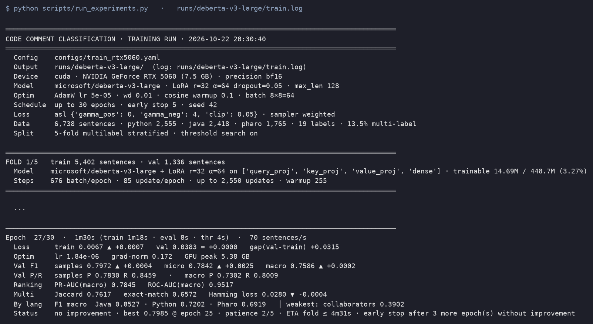
</p>

At the end of the cross-validation, a summary per fold and per label (weakest labels first):

<p align="center">
  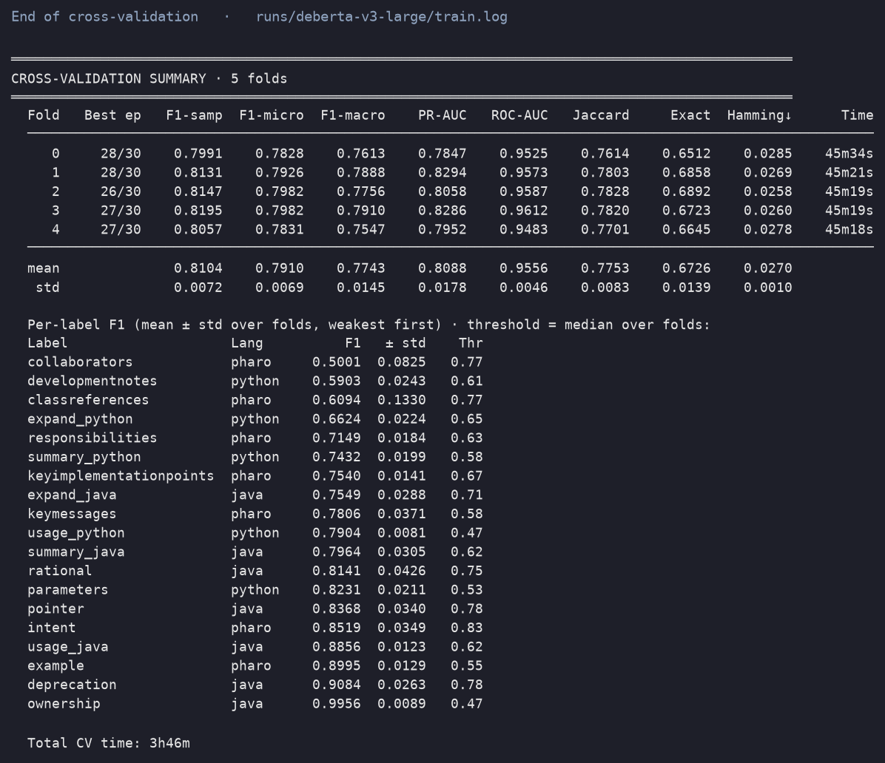
</p>

### 7.2 Configs

| Config | Purpose | Key settings |
|---|---|---|
| `train_rtx5060.yaml` | main method | RoBERTa-large + LoRA, bf16, batch 16 × 4, ≤ 30 epochs, ASL, sampler, prompt, threshold search, final model 25 of 30 epochs |
| `baseline_roberta.yaml` | RoBERTa baseline | same as above but `loss_type: bce` (`pos_weight: false`), `sampler.enabled: false`, no prompt, `threshold_search: false`, no final model |
| `ablation_cls_pooling.yaml` | pooling ablation | same as `train_rtx5060.yaml` but `pooling: cls` (first token `<s>` instead of mean pooling), no final model |
| `smoke_test.yaml` | setup check | roberta-base, 2 folds, 1 epoch, `max_len` 64 |
| `train_l40s.yaml` | upstream config | batch 64, fp32, ≤ 100 epochs; needs a ≈ 46 GB GPU |

Important fields:

```yaml
model_name: "roberta-large"
pooling: "mean"                   # mean of the non-padding tokens | cls = first token (<s>)
precision: "bf16"                 # fp32 | fp16 | bf16
cv: {n_splits: 5, start_fold: 0, skip_if_checkpoint_exists: true}
text_features: {include_lang: true, include_class_id: true, template: "[{lang}] {class_id} | {sentence}"}
peft: {enabled: true, r: 32, alpha: 64, dropout: 0.05, target_modules: ["query", "key", "value", "dense"]}
                                  # target_modules: auto = chosen per architecture (set automatically by --model)
loss_type: "asl"                  # asl | focal | bce (loss_params.pos_weight: true/false)
loss_params: {gamma_pos: 0, gamma_neg: 4, clip: 0.05}
sampler: {enabled: true, type: "weighted"}
train_params: {batch_size: 16, grad_accum: 4, epochs: 30, lr: 0.00005, scheduler: cosine, warmup: 0.10, seed: 42}
eval: {threshold_search: true}
logging:
  early_stop: 5                   # patience on F1 (samples)
  min_epochs: 10                  # never stop before this epoch
  per_label_table: best           # optional (default best): best | every | none
  save_trainable_only: true       # checkpoints keep only LoRA + head (≈ 57 MB instead of ≈ 1.4 GB)
final_training: {enabled: true, epochs: 25, schedule_epochs: 30}   # 25 epochs on the 30-epoch LR schedule of CV
```

`final_training.schedule_epochs` lets the final model stop at the mean best epoch of CV while keeping the same learning-rate schedule, so the median CV thresholds fit it.

### 7.3 All models with one command: `scripts/run_experiments.py`

`configs/experiments.yaml` lists the runs (model, optional own config, output folder, batch). Each runs in its own process:

* finished runs are skipped; interrupted runs resume from their last finished fold (re-run the same command after Ctrl+C or a crash),
* a run whose CV is done but whose final model is missing or outdated only retrains the final model,
* on CUDA out of memory the batch is halved and gradient accumulation doubled, then the run is retried,
* a failing run does not stop the others; tokenizers are pre-checked before anything trains,
* at the end, `compare_runs.py` is called on the runs listed in `compare_runs` (the first one is the reference).

The run behind the results above (RoBERTa final model, RoBERTa baseline, UniXcoder, DeBERTa, ModernBERT) took 11 h 34 min on the RTX 5060. Progress: `runs/experiments.log`; details: `runs/<run>/train.log`.

<p align="center">
  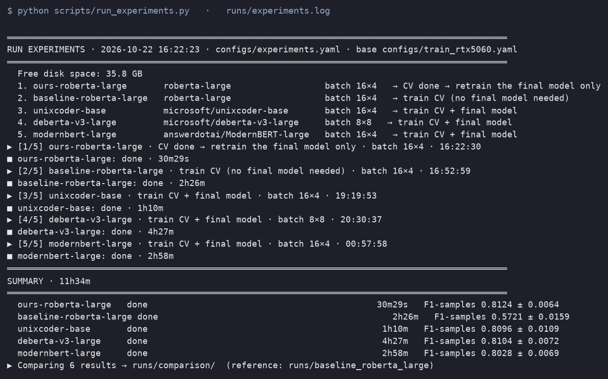
</p>

### 7.4 Output of a run

| File | Content |
|---|---|
| `results.json` | per-fold metrics, mean/std, per-label F1, best epochs, fold times, median thresholds |
| `train.log` | full log: run header, per-epoch report (loss, LR, grad-norm, F1, P/R, PR/ROC-AUC, multi-label metrics, per-language F1, per-label table), CV summary |
| `history_fold{k}.csv` · `curves_fold{k}.png` | metrics of every epoch · loss and F1 curves |
| `best_model_fold{k}.pt` · `best_thresholds_fold{k}.json` · `fold{k}_state.json` | best checkpoint, thresholds and metrics of each fold |
| `oof_fold{k}.npz` | out-of-fold predictions (ids, probabilities, labels, thresholds) for analysis |
| `final_model.pt` · `final_meta.json` | final model with median thresholds, and its settings |
| `config_used.yaml` | the exact config of the run (after command-line overrides) |

**What is in git:** every file above except the model weights (`*.pt`, ≈ 57 MB to 1.4 GB each) and the logs (`*.log`), see `.gitignore`. The committed results (≈ 7 MB in total) are enough to re-run `compare_runs.py`, `analyze_oof.py` and `make_figures.py`; the demo and `rebuild_oof.py` need the weights, so retrain them with `scripts/run_experiments.py` or share them separately (e.g. GitHub Releases or the Hugging Face Hub).

---

## 8. Baselines

Both baselines use the same 5 folds and write `results.json` in the same format.

* **TF-IDF + Logistic Regression** — `python scripts/ml_baseline.py` → `runs/ml_tfidf_logreg/`. Word TF-IDF (1–2 grams) + character TF-IDF (2–5 grams, `char_wb`), ≈ 49k features, fitted on each training fold; One-vs-Rest Logistic Regression (C = 4, balanced class weights); per-label thresholds as in `train.py`. Options: `--model rf` (Random Forest), `--no-threshold-search`.
* **RoBERTa baseline** — `python src/train.py configs/baseline_roberta.yaml` → `runs/baseline_roberta_large/`. Plain fine-tuning of the same RoBERTa-large + LoRA (see the recipe table in [§2](#2-approach)).

---

## 9. Evaluation and analysis tools

| Command | Output |
|---|---|
| `python scripts/compare_runs.py RUN_A RUN_B …` | overview table (mean ± std of 8 metrics, best epoch, time), fold-by-fold Δ vs the first run, macro F1 per language, F1 per label; saves `summary.csv`, `per_label_f1.csv`, `per_label_f1.png` to `--out` (default `runs/comparison/`) |
| `python scripts/analyze_oof.py` | prediction behaviour, decision-rule ablation, paired t-tests vs `--reference`, ensemble of `--ensemble` runs, confusions and exact match by subgroup; saves `runs/analysis/analysis.json` |
| `python scripts/rebuild_oof.py RUN` | rebuilds `oof_fold*.npz` and the multi-label metrics of a run trained before they existed (backup: `results.before_rebuild.json`) |
| `python scripts/make_figures.py` | regenerates every figure of this README in `docs/images/` from `runs/` and the dataset (needs `runs/analysis/analysis.json`) |

Metrics: **F1 (samples)** (main metric; F1 of each sentence’s label set averaged over sentences, also used for model selection and thresholds), F1 micro, F1 macro, PR-AUC and ROC-AUC (macro, threshold-independent), Jaccard (samples), exact match (subset accuracy) and Hamming loss.

### Tests

```bash
pip install -r requirements-dev.txt
pytest                                   # whole suite, ≈ 5 s on CPU
pytest tests/test_preprocess.py -v       # one file, one line per test
pytest -k pooling                        # only tests whose name contains "pooling"
```

The suite needs neither a GPU nor the trained weights (the model tests build a tiny random RoBERTa locally).

| File | What it checks |
|---|---|
| `tests/test_preprocess.py` | normalization rules, sentence splitting, class-comment extraction for Java, Python, Pharo Tonel and File Out, prompt format |
| `tests/test_data_and_samples.py` | dataset size and label counts, normalization reproduces the dataset sentences, 19 labels in the configs, the pooling ablation config differs only where intended, every demo file parses and its expected labels match the extracted sentences |
| `tests/test_metrics_and_training.py` | metrics on hand-computed examples, threshold search, Asymmetric Loss vs BCE, weighted sampler, command-line overrides, demo decision rules |
| `tests/test_model.py` | output shapes for mean and first-token pooling, mean pooling ignores padding, LoRA trains only adapters + head, trainable-only checkpoints restore the same predictions |

### Continuous integration and releases

| Workflow | Trigger | What it does |
|---|---|---|
| `.github/workflows/tests.yml` | every push to `main`, every pull request, manual run | `ruff` (syntax errors and undefined names), then the test suite on Python 3.10 and 3.12 with CPU PyTorch (≈ 3–5 min) |
| `.github/workflows/release.yml` | pushing a tag `v*` | runs the tests, then creates a GitHub Release with `results-<tag>.zip` (results, histories, comparisons, analyses, figures) |

```bash
ruff check .                         # same lint as CI (settings in ruff.toml; legacy/ and references/ excluded)
git tag v1.0 && git push origin v1.0                                  # publish a release
gh release upload v1.0 runs/roberta_large_rtx5060/final_model.pt      # then attach the weights (not in git)
```

---

## 10. Demo and inference

```bash
streamlit run demo/app.py                              # web demo
python demo/cli.py demo/examples/DownloadManager.java  # one file in the terminal
python demo/cli.py --all                               # all sample files + accuracy vs expected labels
python demo/cli.py --tests --run runs/unixcoder-base   # test files with another trained model
python demo/cli.py --labels                            # meaning of the 19 labels
```

**Pipeline:** code file → class comments → sentences normalized exactly like `sentences.csv` → prompt → trained model → labels with probabilities.

* **Extraction** (`src/preprocess_comments.py`): Java — Javadoc `/** */` right before `class` / `interface` / `enum` / `record` (annotations allowed in between; `class_id` = file name); Python — class docstrings via `ast` (`class_id` = class name); Pharo — Tonel (`Foo.class.st`, also traits) and File Out (`commentStamp:` chunks), with `""` / `!!` unescaping. Method comments and file headers are ignored, as in the dataset.
* **Normalization:** lowercase; keep letters, digits and `. , @ # ^ % & ? !`; other characters become spaces (`{@link Foo#bar()}` → `@link foo#bar`); a dot inside a word becomes `^`; split at line breaks and sentence-ending dots. Rebuilding known classes of the dataset reproduces its sentences character for character.
* **Web app:** pick a trained run, then a sample file, an upload or pasted code; results grouped by class with colored label chips and probabilities, comparison with expected labels, preprocessing view, prediction table, per-label probabilities, CSV download. Options: only labels of the file’s language (default), at least one label per sentence (default).

| Results by class (with expected labels) | Preprocessing | Probabilities |
|---|---|---|
|  | 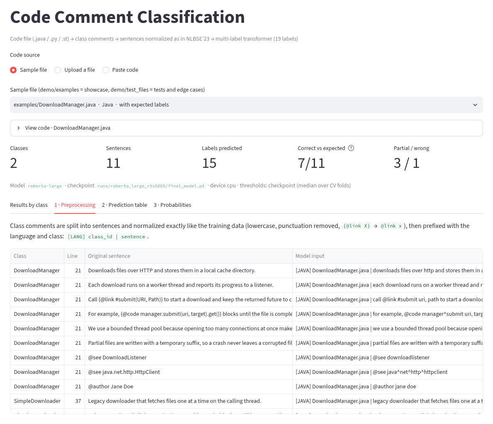 | 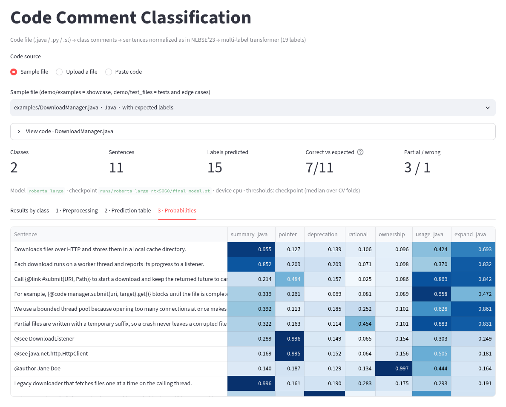 |

**Mock test data:** `demo/examples/` (8 files, 86 annotated sentences, all 19 labels) and `demo/test_files/` (10 files with rarer styles: HTML lists, NumPy and reST docstrings, enum/record/nested classes, Pharo traits and File Out). Reference labels are in `demo/examples/expected_labels.json`; they are hand-written following the dataset’s conventions and are illustrative only. With the main model, 54 / 86 showcase sentences (63%) and 53 / 94 test sentences (56%) match exactly, in line with the cross-validated exact match of 0.68. Typical misses: Pharo section headers (`Instance Variables`), Python `TODO:` notes (no training sentence starts with “todo”), rationale sentences in Java.

**Python API:**

```python
import sys; sys.path.insert(0, "demo")
from inference import load_bundle, classify

bundle = load_bundle("runs/roberta_large_rtx5060/config_used.yaml")      # device="cpu" to force the CPU
rows, probs, labels = classify(bundle, open("demo/examples/DownloadManager.java").read(), "DownloadManager.java")
for r in rows:
    print(r["class"], r["raw"], "->", r["pred"])
```

---

## 11. Evaluation protocol and limitations

* **Thresholds are tuned on the validation folds**, so absolute scores are slightly optimistic. This applies to every method except the RoBERTa baseline (fixed 0.5); comparisons between methods remain fair because all share the same folds and procedure.
* **Folds are built at sentence level**: sentences of the same class can be in training and validation. A class-level (grouped) split would be stricter.
* **Not the official NLBSE’23 protocol**, which averages the F1 of 19 binary tasks on the fixed `partition` test split; our numbers are therefore not directly comparable with published ones. F1 macro is the closest of our metrics.
* **Five folds** give limited statistical power; small differences (e.g. ModernBERT, p = 0.03) are weak evidence.
* The prompt, loss and sampler were evaluated **together**; their individual effects need separate ablation runs.
* Every transformer result above uses **mean pooling** (the RoBERTa baseline too), so the gain over the baseline does not come from pooling. The pooling ablation ([§3.9](#39-pooling-ablation-mean-pooling-vs-first-token)) finds no significant difference between mean pooling and the first token (+0.0035 F1 samples, p = 0.36). Reproduce it with `python scripts/run_experiments.py --only ablation-cls-pooling`, then `python scripts/compare_runs.py runs/roberta_large_rtx5060 runs/ablation_cls_pooling --out runs/comparison_pooling`.
* The mean-pooling run was trained with an earlier version of `src/train.py` than the ablation; the training logic is the same (only logging, checkpoint format and the `min_epochs` guard changed, and no fold of either run stopped before epoch 23).

---

## 12. Troubleshooting

| Problem | Fix |
|---|---|
| `CUDA out of memory` | Use `configs/train_rtx5060.yaml` (default), not `train_l40s.yaml`; lower `--batch-size` and raise `--grad-accum`; `run_experiments.py` does this automatically. Close other GPU programs (e.g. a running demo). |
| GPU not supported / not detected (RTX 50xx) | Install a PyTorch build for CUDA 12.8 or newer. |
| DeBERTa tokenizer error | `pip install sentencepiece` |
| ModernBERT not found | Upgrade transformers (≥ 4.48). |
| A run stopped in the middle | Re-run the same command (`run_experiments.py`, or `train.py --resume`). |
| Results of an older run lack Jaccard / exact match / Hamming | `python scripts/rebuild_oof.py runs/<run>` |
| Demo says “No trained model found” | A run folder needs `config_used.yaml` and `final_model.pt`. Model weights are not in git: retrain (`python scripts/run_experiments.py`) or copy them into `runs/<run>/`. |
| Disk space | Keep `logging.save_trainable_only: true` (≈ 57 MB per RoBERTa-large checkpoint instead of ≈ 1.4 GB). |

---

## 13. Legacy code and references

* `legacy/` — the upstream per-category scripts (TF-IDF + classical models per language and category). They need data files and modules that are not in this repository and solve 19 binary tasks on the fixed split; see `legacy/README.md`. The runnable ML baseline is `scripts/ml_baseline.py`.
* `references/STACC/` — notebooks of STACC (Al-Kaswan et al.), a NLBSE’23 submission based on SetFit with 19 binary classifiers.

---